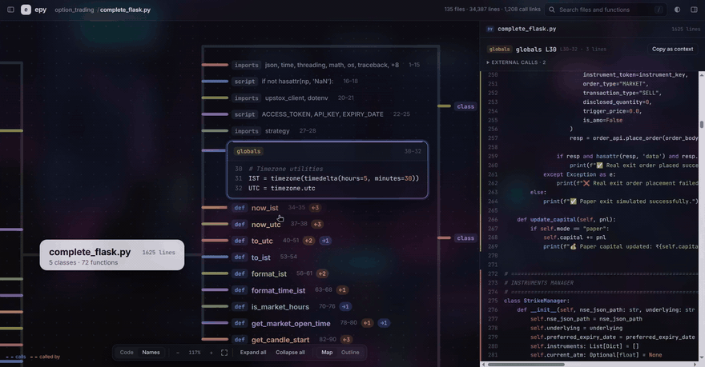
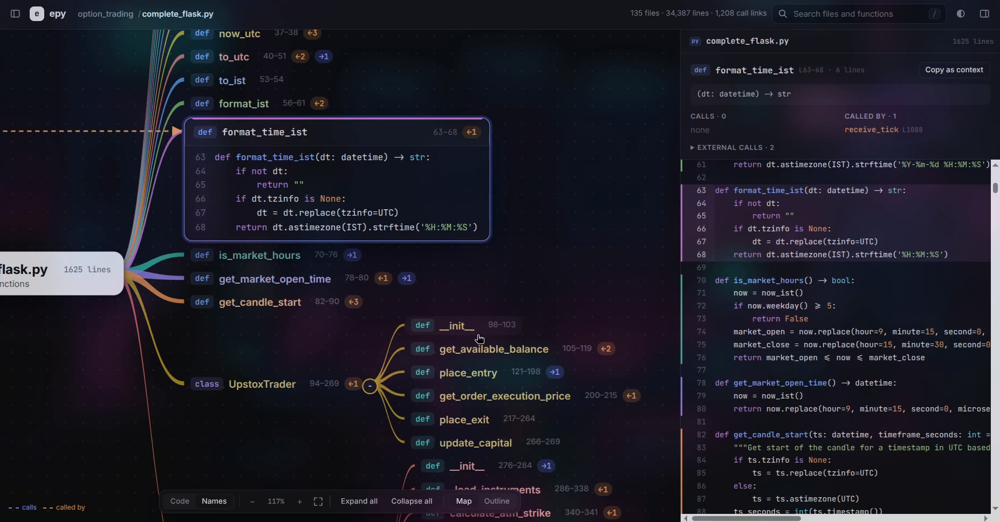
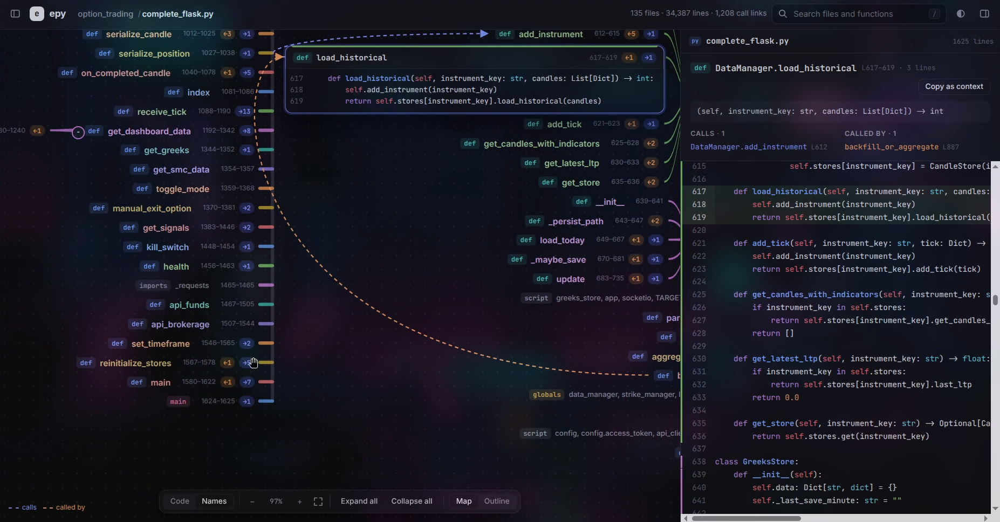
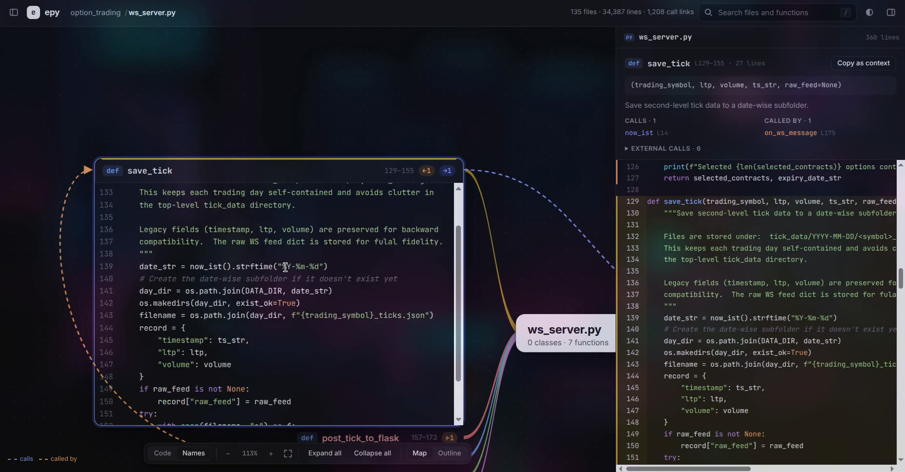
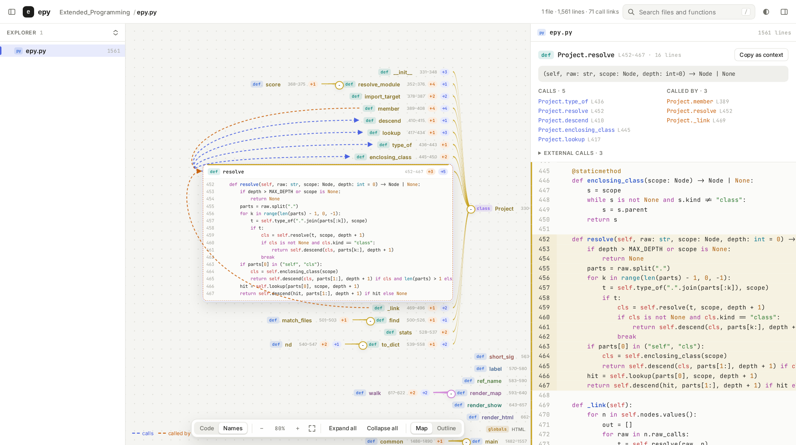

# epy: Extended Python

This project was cloned from https://github.com/phoenix2610/Extended_Programming.

Originally, everything was in a single file. I am restructuring it with the help of the program itself which is extremely helpful in viewing the structure and figuring out how best to
separate it into multiples files.

The original readme is below.

## Original readme

**Open a Python file and see it as a mind map, where every branch holds the actual code.**

epy cuts each file into its blocks (imports, globals, classes and their methods, functions, the `__main__` guard) and lays them out around the file like a Coggle mind map. Every card shows that block's real source with its line range, and every block is linked to what it calls and what calls it, including across files.

It's a single Python file that uses only the standard library and writes one self-contained HTML page.



---

## Why

Long files get read top to bottom, but code is a graph. Tools that draw call graphs usually show only names, and editors show the code but not how it fits together. epy keeps both on one screen: the structure of the whole file as a map, the code of any block one click away, and the full file open beside it.

The idea comes from the execution model of **EPL**, a small programming language I'm building, where programs are thought of as isolated, line-ranged blocks wired together.

## Screenshots

**Names mode.** Every block is a label, and the one you click opens up as a code card in place.


**Call arrows.** Select a block to see what it calls (blue) and what calls it (orange).


**Map and code in sync.** The full file sits on the right; clicking a card scrolls to it and clicking a line selects its block.


**Light theme.** Here epy is mapping its own source.


## Quick start

Requires Python 3.9 or newer. Nothing to install.

```bash
git clone https://github.com/phoenix2610/Extended_Programming.git
cd your-project
python /path/to/Extended_Programming/epy.py view some_file.py
```

`view` builds the page for the whole folder (so links across files work) and opens it in your browser on that file.

## Commands

| Command | What it does |
|---|---|
| `epy.py view PATH` | Build the page and open it in the browser. If `PATH` is a file, the project root is the current folder when the file is inside it, otherwise the file's own folder (override with `--root DIR`). |
| `epy.py html PATH -o out.html` | Write the interactive page to a file. `--no-source` leaves the code out and keeps only the structure. |
| `epy.py map PATH [-o out.epy]` | Print the plain-text block map. `--depth N` limits nesting, `--no-calls` hides call lists, `--external` also lists calls into libraries. |
| `epy.py show PATH TARGET` | Print one block's code with its calls and callers. `TARGET` can be `file.py::Class.method`, `Class.method`, `file.py:120` (the block containing line 120) or `file.py`. |
| `epy.py json PATH -o out.json` | Write the raw graph (every block, its line range, children and call links). |

Every command accepts `--exclude GLOB` (repeatable) to skip files. Folders such as `venv`, `.git`, `__pycache__` and `node_modules` are skipped automatically.

## Using the page

| Action | How |
|---|---|
| Pan / zoom | Drag the background / scroll. Pinch and Ctrl+scroll also zoom. |
| Fit the whole map | `f`, or the fit button in the bottom toolbar |
| Fold a branch | Click the round knob on a class or function card; **Expand all** / **Collapse all** for the whole file |
| Code or Names | **Code** shows every card with its code. **Names** shows labels and opens only the selected block as code. |
| Map or Outline | **Outline** shows the same blocks as nested boxes |
| Jump from code to map | Click any line in the code pane |
| Search | `/`, then type a file or function name |
| Deselect | `Esc` |
| Hand a block to an LLM | **Copy as context** in the right pane copies its code plus its call list |

The explorer on the left and the code pane on the right can be resized by dragging their edges, or hidden with the buttons at either end of the top bar. Light and dark themes follow your system, and the half-filled circle button switches between them.

## The text map (`.epy`)

The same structure as plain text, built to be cheap for a person or an LLM to read before opening any code. This is epy mapping itself:

```
@ epy.py  [1-1561] 1561L  "epy — extended python graph."
  ├ doc   "epy — extended python graph."                          [1-19]        19L
  ├ imports __future__, argparse, ast, fnmatch, html, json, +7    [20-33]       14L
  ├ class FileGraph                                               [194-312]    119L  ←1
  │ ├ def __init__(rel: str, src: str)                            [195-211]     17L  → Node, first_line, _imports, _segment
  │ ├ def _segment(body, parent: Node, in_class: bool, prev_en…)  [249-289]     41L  ←2  → category, FileGraph._segment.flush, _def
  ├ class Project                                                 [330-558]    229L  ←1
  │ ├ def resolve_module(mod: str, from_rel: str, level: int) -…  [352-376]     25L  ←4  → Project.resolve_module.score
  │ ├ def member(node: Node, name: str, depth: int) -> Node …)    [389-408]     20L  ←4  → import_target, resolve_module, resolve, member
```

`[a-b]` is the line range, `←n` means n other blocks call this one, and `→` lists the blocks it calls. A typical workflow is to read the map, then run `epy.py show` for just the blocks you need.

## How it works

1. **Cutting files into blocks.** Each file is parsed with Python's `ast`. Top-level statements are grouped into blocks by kind: consecutive imports form one block, assignments form a `globals` block, and so on. Classes and functions become their own blocks, with methods and nested functions as children. Comment lines directly above a block belong to it, so the boxes cover the file in order with no overlaps.
2. **Linking calls.** Each block's call sites are resolved statically and best-effort:
   - names in enclosing scopes and the module,
   - `self.` and `cls.` members, including methods inherited from base classes in the project,
   - imports between project files, including relative imports and re-exports through `__init__.py`,
   - simple local typing such as `engine = Engine(...)` followed by `engine.run()`, including `self.engine = Engine()` set in `__init__`.
3. **Drawing.** The page lays the file's blocks out on both sides of the file name, with tapered branches like a hand-drawn mind map. When a class has many methods, they wrap into columns joined by a shared trunk line, so the map stays wide rather than very tall. All data and code are embedded in the page, so it works offline.

## Limits

- Calls whose target can only be known at runtime don't get arrows: `getattr`, functions stored in dicts, or methods on objects whose type isn't visible (for example, a function parameter). They are listed as external calls instead.
- Functions defined inside a top-level `if` or `try` block don't get their own box yet.
- Python only, for now.

## Roadmap

- **More languages** through a tree-sitter front end. Everything after parsing works on a language-neutral JSON graph (the output of `epy.py json`), so the viewer stays the same.
- **EPL** emitting that same graph directly.
